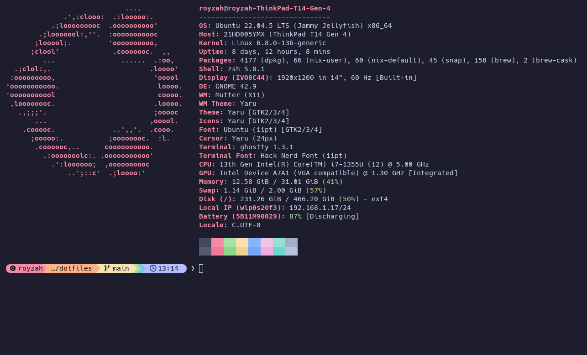

# Dotfiles

A keyboard-first dev environment for embedded, DevOps, and multi-language work.

**Stack:** Ubuntu | Nix | Docker | mise | Ghostty | zsh + Starship | tmux |
Neovim (LazyVim) | Claude Code | Catppuccin Mocha everywhere



## Pick your path

| You are on                         | Start here                                                                |
| ---------------------------------- | ------------------------------------------------------------------------- |
| Ubuntu desktop or laptop           | [LINUX_GUIDE.md](LINUX_GUIDE.md)                                          |
| Linux server, no sudo              | [LINUX_GUIDE.md: No sudo](LINUX_GUIDE.md#no-sudo-shared-servers)          |
| Windows, personal                  | [WINDOWS_GUIDE.md: WSL](WINDOWS_GUIDE.md#personal-windows-wsl)            |
| Windows work laptop + build server | [WINDOWS_GUIDE.md: Thin client](WINDOWS_GUIDE.md#work-laptop-thin-client) |

The short version on Ubuntu:

```bash
git clone https://github.com/royzah/dotfiles.git ~/Code/dotfiles && cd ~/Code/dotfiles
./bootstrap.sh                       # every tool; then log out and back in
./install.sh && ./setup-system.sh    # link configs; desktop setup
just doctor                          # verify
```

## Daily commands

| Command                    | Does                                                        |
| -------------------------- | ----------------------------------------------------------- |
| `just install`             | link configs (idempotent; backs up what was there)          |
| `just system`              | GNOME, keybindings, extensions, web apps, systemd units     |
| `just update`              | apt, brew, mise, rustup, claude, plugins, nix gc            |
| `just doctor`              | report drift from what install/setup would produce          |
| `just hw` / `gpu` / `tune` | show detected hardware / graphics stack / kernel tuning     |
| `just lint` / `fmt`        | shellcheck, shfmt, luacheck, stylua, markdownlint, gitleaks |
| `just test`                | bats tests; `tests/smoke.sh` checks install idempotency     |
| `just backup` / `clean`    | restic backup now / report reclaimable disk                 |
| `dotf <target>`            | any of the above from any directory                         |

## Layout

```text
bootstrap.sh / bootstrap-user.sh   install every tool (with sudo / into $HOME)
install.sh / setup-system.sh       link configs / desktop + systemd
bin/                               scripts; hw-profile.sh gates hardware-specific steps
zshrc + zsh/                       shell, split by topic
nvim/ tmux.conf ghostty/ starship/ editor and terminal
gitconfig ssh_config direnvrc      dev config (machine-local parts stay untracked)
claude/ AGENTS.md templates/       AI agent config and project templates
windows/laptop.ps1                 Windows side: apps, font, Terminal theme (per user)
tests/ .githooks/                  bats + smoke tests, pre-commit leak guard
```

## Guides

- [LINUX_GUIDE.md](LINUX_GUIDE.md): install, daily use, shortcuts, hardware
- [WINDOWS_GUIDE.md](WINDOWS_GUIDE.md): WSL, or a thin client to a build server
- [NVIM_GUIDE.md](NVIM_GUIDE.md) and [TMUX_GUIDE.md](TMUX_GUIDE.md): editor and multiplexer
